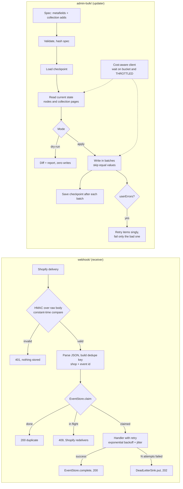

# Shopify commerce lab

Tested reference code for two jobs Shopify agencies hand to developers: receiving webhooks safely, and bulk-editing
product data without damaging a live catalog. TypeScript, Node 20 or newer, no Shopify credentials needed, no runtime
dependencies.

This is a lab. It has never been run against a client store or any live Shopify store.

## What it is

| Module | What it does |
|---|---|
| `webhook/` | Verifies the `X-Shopify-Hmac-Sha256` signature over the raw body with a constant-time compare. Dedupes deliveries by event id (falls back to webhook id) in a pluggable store. Wraps handlers so an event runs to success once. Retries with exponential backoff and full jitter, then writes the event to a dead-letter sink after N attempts. |
| `admin-bulk/` | Bulk updater for product metafields and manual collection membership over the Admin GraphQL API. Dry-run mode prints a diff and sends no mutations. Skips values that already match. Batches writes. Reads `extensions.cost.throttleStatus`, waits before a request when the bucket is short, and waits and retries on `THROTTLED`. Saves a checkpoint after each batch so an interrupted run resumes. Produces a structured report. |
| `tests/` | 44 vitest cases. The bulk updater runs against a mock GraphQL server that lives inside the tests. |

## What it proves

- The signature check rejects forged, altered, re-serialized and unsigned requests, and nothing is stored or run for them.
- A replayed delivery runs the handler once. A delivery that arrives while the first is still processing gets a 409, not a second run.
- A failing handler is retried with growing, jittered waits, then dead-lettered with every error kept. A redelivery of a dead-lettered event does not create a second dead letter.
- A dry run sends zero mutations and writes no checkpoint. A rerun of a finished spec sends zero mutations.
- One rejected value in a batch fails only that item, and the report says which.
- A throttled API slows the run down instead of failing it, and the report records how long it waited.
- A run that dies halfway resumes from its checkpoint without reading or rewriting finished work, and refuses a checkpoint that belongs to a different spec.

## What it does NOT prove

- It has never been run against a client store, a development store or any live Shopify API. The GraphQL documents
  follow Shopify's documented shapes, but the mock does not validate them against Shopify's real schema. Field names,
  limits and error codes need checking on a development store before any real use.
- The mock models the cost bucket with a simple fixed cost per call. Real query costs depend on query shape, so the
  tests prove the wait logic, not Shopify's actual limits.
- No sales, conversion, speed or accessibility result of any kind. Nothing here measures a storefront.
- No theme migration, checkout extensibility, Functions, headless, subscriptions or lifecycle email work.
- It is lab code, not client work. There are no references or testimonials behind it.
- The stores are in memory. Production use needs a durable event store (a unique key in a database or Redis, with
  expiry for finished keys) and a durable dead-letter sink. The interfaces are small so that swap is contained.
- `collectionAddProducts` is meant for manual collections. Smart collections are rule-driven and are out of scope.
- Product metafields and collection membership only. Other owner types are not handled.

## Layout

```
webhook/       verify.ts  store.ts  idempotency.ts  retry.ts  receiver.ts
admin-bulk/    client.ts  spec.ts  plan.ts  diff.ts  checkpoint.ts  runner.ts  queries.ts
tests/         webhook.test.ts  admin-bulk.test.ts  support/mock-shopify.ts
demo/run.ts    dry run, apply, rerun against the mock
docs/          architecture.mmd
```

## Run it

```
npm install
npm test            # vitest, verbose reporter
npm run typecheck   # tsc --noEmit
npm run demo        # builds, then runs dry run, apply and rerun against the local mock
```

Dev dependencies are `typescript`, `vitest` and `@types/node`. Nothing else is installed and there are no runtime
dependencies. The only network use is the mock server on 127.0.0.1.

## Architecture



The same diagram source is in `docs/architecture.mmd`.

## How the pieces fit

Webhook receiver. `createWebhookReceiver(config)` returns `receive({ headers, rawBody })`, which gives back
`{ status, body }`. It does not start a server, so it works behind any framework that can hand over the raw bytes. The
status codes are 401 (bad signature), 400 (no event id, or body is not JSON), 409 (same event in flight), 200
(processed, or already done), 202 (dead-lettered) and 500 (the store or dead-letter sink failed, so Shopify will
redeliver). Parsing happens only after the signature is verified.

Bulk updater. `runBulk({ client, spec, mode, checkpointPath, reportPath })` takes a spec of desired state:

```ts
const spec = {
  metafields: [{ ownerId: "gid://shopify/Product/1", namespace: "custom", key: "care", type: "single_line_text_field", value: "Wash cold" }],
  collectionAdds: [{ collectionId: "gid://shopify/Collection/10", productId: "gid://shopify/Product/1" }],
};
```

It reads current state first, plans create, update or unchanged per operation, and only then writes. If Shopify rejects
a batch with user errors, the items are retried one at a time so a single bad value fails only itself. A checkpoint is
removed after a clean run. After a run with failures it is kept, and deleting it forces a fresh read.

## Demonstration

Exact command:

```
npm test
```

Captured output from this repository (Node 24.18.0, vitest 5.0.3):

```

> shopify-commerce-lab@0.1.0 test
> vitest run --reporter=verbose


 RUN  v5.0.3 /path/to/shopify-commerce-lab

 ✓ tests/webhook.test.ts > signature verification > accepts a correct signature 1ms
 ✓ tests/webhook.test.ts > signature verification > rejects a signature made with another secret 0ms
 ✓ tests/webhook.test.ts > signature verification > rejects missing, empty and wrong-length headers 0ms
 ✓ tests/webhook.test.ts > signature verification > rejects when the secret is empty 0ms
 ✓ tests/webhook.test.ts > signature verification > signs the raw bytes: same JSON with different whitespace fails 0ms
 ✓ tests/webhook.test.ts > receiver > rejects a bad signature with 401 and never runs the handler or stores the event 0ms
 ✓ tests/webhook.test.ts > receiver > rejects a body that was altered after signing 0ms
 ✓ tests/webhook.test.ts > receiver > returns 400 when there is no event id or webhook id 0ms
 ✓ tests/webhook.test.ts > receiver > returns 400 for a signed body that is not JSON, without running the handler 0ms
 ✓ tests/webhook.test.ts > receiver > falls back to the webhook id header when there is no event id 0ms
 ✓ tests/webhook.test.ts > receiver > dedupes a replayed delivery: handler runs once, second answer is 200 duplicate 0ms
 ✓ tests/webhook.test.ts > receiver > treats the same event id from different shops as different events 0ms
 ✓ tests/webhook.test.ts > receiver > answers 409 while the same event is still being processed, and runs the handler once 12ms
 ✓ tests/webhook.test.ts > receiver > retries a failing handler with exponential backoff, then succeeds 1ms
 ✓ tests/webhook.test.ts > receiver > dead-letters after the last attempt and records every error 1ms
 ✓ tests/webhook.test.ts > receiver > does not dead-letter the same event twice when Shopify redelivers it 0ms
 ✓ tests/webhook.test.ts > receiver > dead-letters a PermanentError after one attempt, with no waiting 0ms
 ✓ tests/webhook.test.ts > receiver > answers 500 and releases the event when the dead-letter sink is down, so a redelivery can run 0ms
 ✓ tests/webhook.test.ts > receiver > refuses to be built with an empty secret 0ms
 ✓ tests/webhook.test.ts > backoff > doubles the ceiling per attempt and caps it 0ms
 ✓ tests/webhook.test.ts > backoff > jitter spans zero to the ceiling 0ms
 ✓ tests/webhook.test.ts > backoff > retryWithBackoff stops at maxAttempts and reports attempts 0ms
 ✓ tests/webhook.test.ts > idempotency wrapper and store > releases the key when the handler throws, so the next delivery runs again 0ms
 ✓ tests/webhook.test.ts > idempotency wrapper and store > lets another worker take over once a lease has expired 0ms
 ✓ tests/admin-bulk.test.ts > dry run > prints a diff and writes nothing, not even a checkpoint 14ms
 ✓ tests/admin-bulk.test.ts > apply > writes the planned changes and reports them 5ms
 ✓ tests/admin-bulk.test.ts > apply > a rerun of the same spec is a no-op: zero mutation requests 4ms
 ✓ tests/admin-bulk.test.ts > apply > splits writes into batches of the configured size 6ms
 ✓ tests/admin-bulk.test.ts > apply > treats a changed metafield type as an update, even when the value matches 1ms
 ✓ tests/admin-bulk.test.ts > apply > compares json metafields as data, so key order and spacing do not cause rewrites 0ms
 ✓ tests/admin-bulk.test.ts > apply > reports a missing product as a failure and still applies the rest 2ms
 ✓ tests/admin-bulk.test.ts > apply > isolates one rejected value: the rest of its batch is still written 7ms
 ✓ tests/admin-bulk.test.ts > apply > rejects a spec with duplicate operations before sending anything 1ms
 ✓ tests/admin-bulk.test.ts > apply > does not put the access token in the report or in error text 3ms
 ✓ tests/admin-bulk.test.ts > collections > adds only missing members and reads membership across pages 7ms
 ✓ tests/admin-bulk.test.ts > collections > batches product ids per collection 5ms
 ✓ tests/admin-bulk.test.ts > collections > reports a missing collection as a failure 1ms
 ✓ tests/admin-bulk.test.ts > throttling > waits before a request when the bucket is below the last known cost 3ms
 ✓ tests/admin-bulk.test.ts > throttling > waits out a THROTTLED response using the reported shortfall, then retries 1ms
 ✓ tests/admin-bulk.test.ts > throttling > gives up with ThrottleError after maxThrottleRetries waits 3ms
 ✓ tests/admin-bulk.test.ts > throttling > a large run through a small bucket completes and the report shows the waiting 19ms
 ✓ tests/admin-bulk.test.ts > checkpoint and resume > saves progress when the API fails mid-run, then resumes without redoing finished batches 5ms
 ✓ tests/admin-bulk.test.ts > checkpoint and resume > refuses to resume a checkpoint that belongs to a different spec 3ms
 ✓ tests/admin-bulk.test.ts > checkpoint and resume > keeps the checkpoint when some items failed, so a rerun retries only those 3ms

 Test Files  2 passed (2)
      Tests  44 passed (44)
   Start at  21:22:56
   Duration  214ms (tests 52%, transform 34%, import 12%, worker 2%)
```

The demo command prints a dry run, an apply and a rerun against the mock:

```
npm run demo
```

```
== 1. dry run: status=dry_run
   + metafield   gid://shopify/Product/1 custom.care = "Wash cold" (single_line_text_field)
   ~ metafield   gid://shopify/Product/2 custom.care: "Wash warm" -> "Wash cold"
   + collection  gid://shopify/Collection/10 add gid://shopify/Product/1
   + collection  gid://shopify/Collection/10 add gid://shopify/Product/2
   counts: {"planned":6,"create":3,"update":1,"unchanged":2,"checkpointed":0,"missing":0,"applied":0,"failed":0,"mutationCalls":0}
   client (cumulative): {"requests":2,"throttledResponses":0,"preemptiveWaits":0,"waitedMs":0}

== 2. apply: status=complete
   + metafield   gid://shopify/Product/1 custom.care = "Wash cold" (single_line_text_field)
   ~ metafield   gid://shopify/Product/2 custom.care: "Wash warm" -> "Wash cold"
   + collection  gid://shopify/Collection/10 add gid://shopify/Product/1
   + collection  gid://shopify/Collection/10 add gid://shopify/Product/2
   counts: {"planned":6,"create":3,"update":1,"unchanged":2,"checkpointed":0,"missing":0,"applied":4,"failed":0,"mutationCalls":2}
   client (cumulative): {"requests":8,"throttledResponses":2,"preemptiveWaits":2,"waitedMs":2800}

== 3. rerun of the same spec: status=complete
   (no differences)
   counts: {"planned":6,"create":0,"update":0,"unchanged":6,"checkpointed":0,"missing":0,"applied":0,"failed":0,"mutationCalls":0}
   client (cumulative): {"requests":10,"throttledResponses":2,"preemptiveWaits":4,"waitedMs":4400}
```

The rerun shows zero differences and zero mutation calls. The throttle counters in the apply step come from the mock's
small cost bucket, with a virtual clock so no real waiting happens.

## License

MIT. See `LICENSE`.
